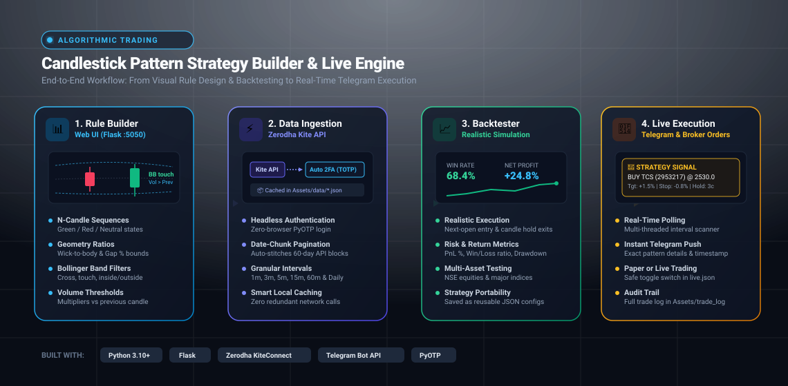

# Candlestick Pattern Strategy Builder & Live Execution Engine

[](https://www.python.org/)
[](https://flask.palletsprojects.com/)
[](https://kite.trade/)
[](https://core.telegram.org/bots/api)
[](https://github.com/pyauth/pyotp)
[](LICENSE)

An end-to-end algorithmic trading framework for designing complex multi-candle chart patterns, backtesting them against high-resolution historical market data from **Zerodha Kite Connect**, and deploying them for real-time paper or live trading with automated **Telegram alerts** and order routing.

---

## Architecture & Workflow



---

## Core Capabilities

### 1. Visual Candlestick Pattern Builder
- **Interactive Web Interface**: Design multi-candle patterns in real time without writing boilerplate code via an integrated Flask-powered Single Page Application (`http://localhost:5050`).
- **Granular Geometric Filtering**:
  - Independent candle color constraints (Bullish / Bearish / Indecision).
  - Configurable wick-to-body ratios (upper wick min/max, lower wick min/max).
  - Body sizing relative to previous candles.
  - Gap-up and gap-down percentage thresholds.
- **Bollinger Band Technical Indicators**:
  - Fully integrated Bollinger Band engine (configurable period & standard deviation).
  - Complex relational triggers: band breakout, band rejection/touch, close above/below middle band, and containment conditions.
- **Volume Dynamics**:
  - Compare candle volume with previous candles.
  - Enforce volume surge multiplier constraints (e.g., $Volume \ge 1.5 \times Volume_{t-1}$).

### 2. Automated Historical Data Engine
- **Headless Zerodha Kite Authentication**:
  - Authenticates automatically using `requests` and `pyotp` (TOTP 2FA) without requiring manual browser redirects or external webviews.
  - Daily session caching in `Assets/zerodha_token.json` to eliminate redundant authentications.
- **Automated Pagination & Data Stitching**:
  - Handles Kite Connect's historical date-window limits by automatically paginating requests in 60-day chunks and concatenating candles seamlessly.
- **Smart Local Disk Cache**:
  - Caches historical time series on disk (`Assets/data/*.json`) to accelerate subsequent backtest iterations and prevent API rate-limit exhaustion.

### 3. Realistic Strategy Backtester
- **Trade Execution Simulation**:
  - Next-candle open entry logic to prevent lookahead bias.
  - Configurable exit rules: Profit Target (%), Stop-Loss (%), and maximum candle holding period.
- **Comprehensive Analytics**:
  - Real-time computation of Win Rate, Total Trades, Average Return, Net PnL %, Max Drawdown, and Win/Loss distribution.
- **Portable JSON Strategy Presets**:
  - Strategies are serialized and saved under `Assets/strategies/` as transparent, versionable JSON definitions (e.g., `my_strategy.json`, `ggbfc.json`).

### 4. Live Signal Scanner & Telegram Execution Engine
- **Multi-Stock & Multi-Interval Scheduler**:
  - Concurrently monitors multiple instruments from `all_stocks.json` across any timeframe (1m, 3m, 5m, 15m, etc.).
  - Evaluates patterns exactly upon candle close using multi-threaded execution.
- **Instant Telegram Broadcasts**:
  - Sends rich markdown trade alerts directly to your Telegram channel or personal chat with entry price, trigger timestamp, stop loss, and target levels.
- **Paper & Live Trading Modes**:
  - Configurable in `live.json` with safeguards (`LIVE_TRADING: false` for paper simulation).
  - Places MIS / CNC market or limit orders directly via the Kite Connect API when live mode is activated.

---

## Project Structure

```
candle-pattern-backtester/
├── Assets/
│   ├── data/                 # Cached historical market candles (*.json)
│   │   └── .gitkeep
│   ├── strategies/           # Saved strategy templates (*.json)
│   │   ├── ggbfc.json
│   │   └── my_strategy.json
│   ├── workflow.svg          # Architectural workflow diagram
│   └── zerodha_token.json    # Local session token cache (git-ignored)
├── ui_static/
│   └── index.html            # Responsive single-page web UI for strategy builder
├── all_cred.json.example     # Credential template for Zerodha & Telegram
├── all_stocks.json           # Active watchlist mapping symbols to Kite instrument tokens
├── backtest.py               # Flask application & interactive backtest runner
├── live.json                 # Execution parameters (capital, slippage, order types)
├── live_zerodha.py           # Real-time multi-threaded scanner & live order execution
├── NSE.csv                   # Zerodha NSE instruments master reference
├── requirements.txt          # Python package dependencies
├── utils.py                  # Candlestick geometry & Bollinger Band calculation engine
└── utils_get_data.py         # Headless Zerodha 2FA login & historical data fetching
```

---

## Quickstart Guide

### 1. Prerequisites
- Python 3.10 or higher
- A [Zerodha Kite Connect](https://kite.trade/) Developer account
- A [Telegram Bot](https://t.me/BotFather) token and chat ID (for live alerts)

### 2. Environment Setup

Clone the repository and set up a virtual environment:

```powershell
# Navigate into the project folder
cd candle-pattern-backtester

# Create and activate virtual environment
python -m venv .venv

# On Windows (PowerShell):
.venv\Scripts\Activate.ps1
# On Linux / macOS:
source .venv/bin/activate

# Install required dependencies
pip install -r requirements.txt
```

### 3. Configure Credentials

Copy the template configuration file:

```powershell
cp all_cred.json.example all_cred.json
```

Edit `all_cred.json` with your credentials:

```json
{
  "telegram_bot_token": "YOUR_TELEGRAM_BOT_TOKEN",
  "telegram_chat_id": "YOUR_TELEGRAM_CHAT_ID",
  "broker": "zerodha",
  "zerodha": {
    "user_id": "YOUR_ZERODHA_CLIENT_ID",
    "password": "YOUR_ZERODHA_PASSWORD",
    "totp_secret": "YOUR_ZERODHA_TOTP_KEY",
    "api_key": "YOUR_KITE_API_KEY",
    "api_secret": "YOUR_KITE_API_SECRET"
  }
}
```

> [!TIP]
> **Finding your TOTP Key**: In Zerodha Console / Kite Web settings, go to Password & Security -> External 2FA Authenticator -> Can't scan QR code? -> Copy the TOTP alphanumeric secret key into `totp_secret`.

### 4. Configure Monitored Stocks

Define the instruments you want to backtest or scan in `all_stocks.json`:

```json
{
  "TCS": "2953217",
  "INFY": "408065",
  "RELIANCE": "738561",
  "HDFCBANK": "340481",
  "NIFTY 50": "256265"
}
```

*Instrument tokens can be looked up in `NSE.csv` or obtained from Zerodha's instrument API.*

---

## Running the Strategy Builder & Backtester

Launch the interactive web application:

```powershell
python backtest.py
```

The server starts at `http://localhost:5050` and automatically opens in your default web browser.

- **Build Pattern**: Click `+ Add Candle` to specify color, body/wick conditions, and Bollinger Band interactions.
- **Select Stock & Interval**: Choose the instrument and time frame (e.g., 5-minute, 15-minute).
- **Run Backtest**: Fetch fresh historical data or use cached data, then inspect the resulting trade log, win rate, and total return.
- **Save Strategy**: Save your validated setup directly to `Assets/strategies/` for live execution.

---

## Running Live Market Monitoring & Paper Trading

To monitor markets in real time and receive Telegram alerts:

1. Configure runtime risk parameters in `live.json`:
   ```json
   {
     "LIVE_TRADING": false,
     "TOTAL_CAPITAL": 100000,
     "MONEY_PER_STOCK": 10000,
     "DEFAULT_QUANTITY": 1,
     "ORDER_PRODUCT": "MIS",
     "ORDER_TYPE_ENTRY": "MARKET",
     "ORDER_EXCHANGE": "NSE",
     "FETCH_DELAY_SECONDS": 3
   }
   ```
2. Start the live engine:
   ```powershell
   python live_zerodha.py
   ```

The script monitors all active strategies in `Assets/strategies/`, checks for pattern matches at every candle close, and pushes instant notifications with trade recommendations to your Telegram.

---

## Security & Best Practices

- **Never Commit Secrets**: `all_cred.json`, `Assets/zerodha_token.json`, and `Assets/trade_log.json` are excluded in `.gitignore`.
- **Pre-flight Paper Trading**: Always test new strategies with `LIVE_TRADING: false` in `live.json` before activating live capital.
- **Risk Disclaimer**: Algorithmic trading and backtesting past performance do not guarantee future market returns. Use at your own discretion.

---

## License

This project is licensed under the MIT License — see the [LICENSE](LICENSE) file for details.
